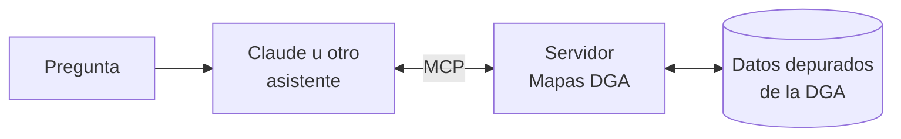

# MCP de Mapas DGA

Servidor [MCP](https://modelcontextprotocol.io) (Model Context Protocol) que facilita la consulta de los
datos históricos que publica la **Dirección General de Aguas (DGA)** en
[Mapas DGA](https://mapas2.mop.gob.cl) desde un asistente de IA (Claude u otro cliente MCP), haciendo las
preguntas en lenguaje natural. Es una herramienta gratuita y sin fines comerciales, que no reemplaza ni
representa a los canales oficiales de la DGA.

## Cómo usarlo

Agregar esta dirección como conector personalizado en cualquier cliente MCP que admita servidores remotos.
No requiere cuenta, clave ni instalación.

```
https://mcp-dga-mapas2.mcp-hidro-chile.workers.dev/mcp
```

## Qué se puede consultar

- Búsqueda de estaciones por nombre, región, comuna, tipo de dato o cercanía a un punto, y ficha de cada
  una con su período y porcentaje de datos faltantes.
- Series diarias, mensuales o anuales de caudal (784 estaciones) y precipitación (1 152) desde 1960
  hasta octubre de 2026, y de temperatura mínima, media y máxima (316 estaciones, de las que solo 20
  tienen datos desde 2025).
- Estadísticas: régimen mensual, valores anuales, curva de duración y extremos.
- Niveles estáticos de 1 340 pozos, con su tendencia y cambio entre períodos.
- Calidad de aguas superficiales y subterráneas de 2 181 estaciones desde 1959, con los valores bajo el
  límite de detección identificados como tales.
- Concentración de sedimentos en suspensión, por muestreo rutinario (1962 a 2018) e integrado (1985 a
  2023).

El portal de la DGA entrega las series diarias desde 1960, aunque algunas estaciones tienen registros
anteriores.

Cada respuesta indica unidades, porcentaje de datos faltantes, valores corregidos o dudosos del período y
la cita de la fuente.

Algunos ejemplos de preguntas:

- ¿Cuál es el caudal medio mensual del río Maipo en El Manzano entre 1990 y 2020?
- ¿Cuánto ha bajado el nivel de los pozos de Copiapó en los últimos diez años?
- ¿Qué estaciones de calidad de aguas del río Loa miden arsénico y cuál es su mediana?

## Depuración de los datos

Las series se publican tal como las entrega la DGA, salvo los errores evidentes. Cada uno se corrige
cuando el valor correcto se deduce sin ambigüedad y se elimina cuando no. Los valores dudosos pero
posibles, como una crecida extrema o una helada muy intensa, se conservan sin cambios y marcados.

| Caso | Ejemplo en los datos de la DGA | Tratamiento |
|---|---|---|
| Valor de relleno | 999,9 mm de precipitación diaria durante todo septiembre de 2020 (Salado Embalse) | Se elimina |
| Coma decimal corrida | 390,1 °C de temperatura máxima (Los Loros) | Se corrige si el resultado calza con los datos vecinos; si no, se elimina |
| Mínima mayor que máxima | Mínima de 8,0 °C y máxima de -3,0 °C el mismo día (Caquena, 24-10-1979) | Se intercambian si ambos valores calzan con los días vecinos; si no, se eliminan |
| Valor imposible | Precipitación de -2 mm, pH de 7 351, temperatura del agua de 2 631 °C | Se corrige la coma si corresponde; si no, se elimina |
| Valor repetido imposible | 48 mm de lluvia diaria durante 118 días seguidos (Río Cancosa en El Tambo, 2020) | Se elimina |
| Fecha duplicada | El mismo día dos veces, con 3,8 y 3,8185 m³/s (Río Colpitas en Alcerreca) | Se conserva un valor |
| Fecha inexistente | Medición de pozo fechada el 01-01-1900; muestra de sedimentos fechada en 2049 | Se corrige el año si las mediciones vecinas lo determinan; si no, se elimina |
| Hora mal escrita | «08:3» en muestras de sedimentos | Se completa como 08:30 |
| Unidad mal rotulada | Conductividad en «mhos/cm» con valores propios de µS/cm | Se corrige la unidad |
| Parámetro mal rotulado | Oxígeno disuelto en mg/l con valores propios de porcentaje de saturación | Se corrige el nombre del parámetro |
| Coordenada mal escrita | 60 segundos en una coordenada; latitud a la que le falta un dígito | Se corrige la coordenada |

La temperatura media diaria que publica la DGA es el promedio de la mínima y la máxima, por lo que se
recalcula con los valores ya depurados.

Cada cambio queda registrado con el valor original, el valor corregido y el motivo, y se puede consultar
desde el propio servidor. Por ejemplo, la estación Los Loros (03430007) registra una máxima de 390,1 °C
el 20 de diciembre de 2016, entre 38,0 °C el día anterior y 39,0 °C el siguiente. Al correr la coma un
lugar el valor queda en 39,01 °C, que calza con los días vecinos, y el registro queda así:

```
estación 03430007 · tmax · 2016-12-20 · valor original 390,1 °C · valor corregido 39,01 °C
motivo: coma decimal corrida (días vecinos 38,0 y 39,0 °C)
```

Los valores mensuales y anuales se calculan desde las series diarias depuradas y solo con meses
suficientemente completos.

## Cómo funciona



## Calidad y seguridad

Cada cambio pasa por pruebas automáticas y análisis de seguridad antes de publicarse, se prueba en una
versión de vista previa y llega a producción solo con aprobación manual. El servicio se verifica a diario.
El detalle y la forma de reportar vulnerabilidades están en [SECURITY.md](SECURITY.md).

## Fuente y cita

Los datos provienen de la Dirección General de Aguas del Ministerio de Obras Públicas de Chile y fueron
descargados de Mapas DGA el 22 de noviembre de 2026. Al usarlos, citar la fuente original:

Dirección General de Aguas (DGA), Ministerio de Obras Públicas. Mapas DGA. https://mapas2.mop.gob.cl

## Licencia y autoría

El código se distribuye bajo la licencia [GNU GPL v3](LICENSE) o posterior. Los datos son información
pública de la Dirección General de Aguas y se ofrecen depurados, sin fines comerciales y citando su
origen; para usos oficiales o legales debe consultarse directamente a la DGA.

Servidor desarrollado por Diego Herrera Pino.
